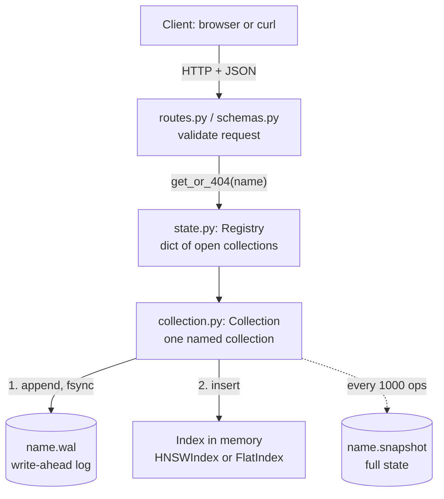
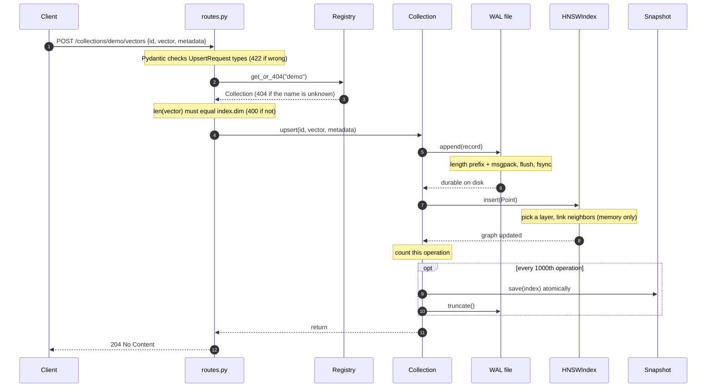
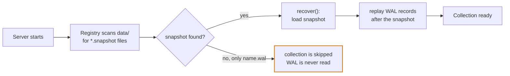

# Architecture

How a write travels through vector-db, and how the system rebuilds itself
after a restart. The diagrams are Mermaid, which GitHub renders directly.

The design rests on one split. Searching has to be fast, so the search
structure (the HNSW graph) lives in memory. Memory is lost when the process
dies, so every change is also recorded on disk. Everything below is the
machinery that keeps those two copies in agreement.

## 1. The layers

Each layer has one job and only talks to the layer below it. Reading the code
top to bottom follows a request down this stack.

Solid arrows run on every write. The dashed arrow runs only when the
operation counter reaches `SNAPSHOT_EVERY_N_OPS`. The two cylinders are the
only things that survive a crash.

| File | Job |
|---|---|
| `api/routes.py` | HTTP only: status codes, 400/404 handling |
| `api/schemas.py` | Pydantic models for request bodies |
| `api/state.py` | Registry: finds a collection by name |
| `collection.py` | Orders the steps: WAL first, then memory |
| `core/hnsw/index.py` | The search graph, memory only |
| `storage/*.py` | WAL, snapshot, recovery on startup |

## 2. One upsert, step by step

The order inside `Collection.upsert` is the durability guarantee: the log
record reaches disk before the in-memory graph changes. If the process dies
between those two steps, the log already has the write, and recovery replays
it.

A crash can land in three places:

| Crash happens | State after restart | Outcome |
|---|---|---|
| Before the WAL write | Nothing recorded, and the client never received a `204` | The client retries. No loss, because success was never promised. |
| After the WAL write, before the index insert | The WAL has the record, memory is gone anyway | Recovery replays the record. |
| After both | Same as above | Rebuilt from the WAL or a snapshot. |

A crash in the middle of a WAL write can leave a partial record at the end of
the file. `WAL.read_from` stops when a payload is shorter than its length
prefix, so a torn final record is ignored instead of breaking recovery.

### Why snapshots exist

The WAL alone could rebuild everything by replaying it from the beginning.
That gets slower the longer the system runs, and for HNSW each replayed
`upsert` re-runs a graph insert (a search plus neighbor selection). A snapshot
stores the finished graph, so loading it skips that work. `Collection.flush`
saves the snapshot and then truncates the WAL, so the log only ever holds
writes made since the last snapshot.

The snapshot is written to `name.snapshot.tmp` and then renamed over
`name.snapshot`. The rename is atomic, so a crash during the write leaves the
previous complete snapshot untouched.

## 3. Startup after a restart

Recovery rebuilds the in-memory index from disk: load the snapshot if there is
one, then replay every log record written after it.

## Known gaps

- **A collection with no snapshot is not reopened after an unclean exit.** A
  collection gets its first snapshot after 1000 writes or a clean shutdown.
  `Registry._load_existing` only looks for `*.snapshot` files, so a collection
  that has only a `.wal` is skipped on restart even though its writes were
  fsynced. Reproduced by creating a collection, upserting one vector, and
  starting a new `Registry` without calling `close()`. The fix needs the
  Registry to also scan `*.wal` files and a way to recover `dim`, `metric` and
  `index_type` for a collection that has no snapshot header.
- **The snapshot temp file is not fsynced before the rename.** The rename
  protects against a process crash. Surviving a power loss also needs an
  `fsync` of the temp file before `replace`.
